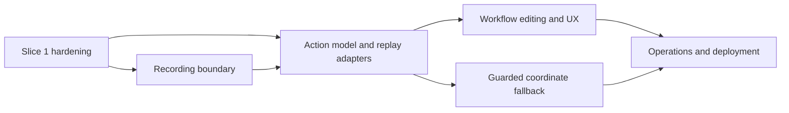

# TeachMeOnce implementation backlog

This is the prioritized product backlog after POC-08. It is intentionally
separate from the feasibility harnesses. A checkbox means the implementation
has passed its acceptance criteria, not merely that source files exist.

## Delivery order

## P0 — Product Slice 1: harden the existing semantic workflow

**Goal:** Make the current same-integrity, one-button semantic workflow a
repeatable product slice before broadening scope.

**Dependencies:** Current `TeachMeOnce.App`, `TeachMeOnce.Application`, and
`TeachMeOnce.Automation` source.

| ID | Work item | Acceptance criteria |
| --- | --- | --- |
| P0.1 | Rebuild and run application contract tests after persistence hardening | Release solution build succeeds; `TeachMeOnce.Application.Tests` passes; malformed and unsupported files produce issues while valid files remain loaded |
| P0.2 | Prove restart flow on interactive Windows | Record demo click, Stop/save, close app, relaunch, load workflow, Replay, and observe `Status: invoked` with a completed result |
| P0.3 | Add a focused restart/replay smoke harness or documented manual evidence | The flow is repeatable from a clean per-user test directory and does not depend on stale `AutomationElement` instances |
| P0.4 | Correct result/diagnostic fidelity | Cancellation, timeout, zero matches, duplicate matches, context mismatch, unsupported pattern, and provider error remain distinguishable in the UI/log |
| P0.5 | Review current synchronous diagnostics and verification polling | No blocking work runs on the WPF thread; file/log paths are user-scoped; verification has bounded timeout and cancellation |

**P0 completion gate:** Release build, dependency-free application tests, and
the interactive restart flow pass. No new action type or external-process
recording starts before this gate.

## P1 — Recording boundary and external target scope

**Goal:** Promote the proven POC-02 capture/correlation behavior into a reusable
product service without putting hooks in WPF code-behind.

**Implementation state:** The reusable Windows target-selection, integrity,
bounded-hook, live-correlation, redaction, Invoke/SetValue/TextInput, and WPF
Attach flows are implemented in the product boundaries. The Release build,
application contract tests, POC-02 correlation evidence, interactive Notepad
recording, and restart/replay acceptance flow have been verified on Windows.
Replay reacquires the top-level window at each action and during bounded
verification waits. Duplicate visible windows remain an explicit `Ambiguous`
refusal.

**Dependencies:** P0; POC-02 evidence; POC-03 target descriptor; POC-06
integrity policy.

| ID | Work item | Acceptance criteria |
| --- | --- | --- |
| P1.1 | Define immutable raw-input, window-context, correlated-event, and recording-session contracts | Contracts contain monotonic sequence, event kind, injected flag, coordinates/key metadata, HWND/PID/process context, target/focus descriptors, and correlation failure |
| P1.2 | Extract hook ownership and bounded queue into a reusable library | Dedicated hook/message-loop lifetime; overflow is explicit; stop/dispose works on success, cancel, and app shutdown; no raw callback blocking |
| P1.3 | Integrate target/process/integrity filtering | Events outside the selected target are excluded; injected replay events are excluded by default; higher-integrity targets return `Unsupported` |
| P1.4 | Add semantic event grouping and redaction | Mouse down/up and key pairs are ordered/coalesced; password/sensitive fields are refused or redacted; no raw secret is persisted or logged |
| P1.5 | Add target selection UX | User can select a same-integrity process/window and see the scope before recording; loss of target ownership stops or pauses recording explicitly |
| P1.6 | Replace demo-only recorder interface with session-based recorder | The application can save a workflow made from a real recorded semantic action; demo recording remains a test fixture, not the production path |

**P1 completion gate:** A real same-integrity WPF/WinForms fixture can be
selected, recorded, saved, closed/reopened, and replayed. POC-02 reports still
pass, queue overflow is tested, and sensitive-input tests show redaction/refusal.

## P2 — Action model, adapters, and verification

**Goal:** Support a small explicit set of UIA action patterns with safe,
observable replay.

**Dependencies:** P0; P1 target/recording contracts; `TeachMeOnce.Automation`.

| ID | Work item | Acceptance criteria |
| --- | --- | --- |
| P2.1 | Define action adapter interface and action registry | Each action declares required UIA patterns, preconditions, execution, verification, and failure mapping; unknown action types and descriptors missing declared capabilities are rejected |
| P2.2 | Add `SetValue`, `Toggle`, `Select`, and `ExpandCollapse` adapters | `SetValue`, `Toggle`, `Select`, and `ExpandCollapse` are implemented with enabled/pattern checks, explicit expected state, cancellation, and bounded postcondition verification |
| P2.3 | Separate target context from action payload | Descriptors have process/window/ancestor context; action payload contains only type-specific data; no COM/UIA objects serialize |
| P2.4 | Add schema migration registry | Version 1 remains readable; future changes use pure versioned migrations with fixture files; unknown future versions are rejected |
| P2.5 | Improve stale-provider and retry policy | Only known stale-provider failures may reacquire the same descriptor within a bounded count; ambiguity and unsafe context never retry elsewhere |
| P2.6 | Add multi-action workflow execution | Replay reports current action, completed count, cancellation, partial failure, and verification result without hiding the failed action |

**P2 completion gate:** All supported adapters have deterministic resolution,
wait, cancellation, verification, and regression tests. A workflow with at
least three action types survives a restart and reports a deliberately failed
middle action correctly.

## P3 — Workflow library and editing UX

**Goal:** Make workflows understandable and reviewable before execution.

**Dependencies:** P1 and P2.

| ID | Work item | Acceptance criteria |
| --- | --- | --- |
| P3.1 | Add workflow metadata and status views | Library shows name, action count, schema status, modified time, and last result |
| P3.2 | Add action list/details editor | The workflow panel exposes action type, target process/control, required patterns, expected state, schema, and sensitive-target warnings without displaying input values; editing remains future work |
| P3.3 | Add safe rename/delete/export/import | Confirmed user-scoped deletion is implemented by workflow ID and covered by contract tests; rename/export/import remain future work |
| P3.4 | Add permissions/settings guidance | UI explains UIA/interactive desktop requirements, same-integrity limitation, data path, and sensitive-input policy without offering silent elevation |
| P3.5 | Add replay progress/recovery UX | Current action and state are visible, visible diagnostics are bounded, cancellation is immediate at a safe boundary; diagnostic IDs and retry eligibility remain future work |

**P3 completion gate:** A user can review and edit a workflow without opening
JSON manually, understand why an action is unsafe/unsupported, and recover from
a failed replay without deleting valid library entries.

## P4 — Guarded custom-rendered fallback

**Goal:** Productize coordinate fallback only where its safety evidence is
available.

**Dependencies:** P2 action registry; POC-05 display evidence; POC-07 fallback
evidence; same-integrity policy.

| ID | Work item | Acceptance criteria |
| --- | --- | --- |
| P4.1 | Define versioned `CoordinateFallback` contract | Stores coordinate space, monitor/DPI/geometry, safe region, evidence, uniqueness, and postcondition; semantic actions cannot silently convert |
| P4.2 | Integrate preflight guards | Current HWND/PID, foreground, visibility, ownership, DPI conversion, containment, safe point, uniqueness, and integrity are checked immediately before input |
| P4.3 | Add post-action confirmation | One bounded input sequence is followed by a required observable confirmation; failure never retries at another point |
| P4.4 | Add review warning and unsupported result | UI clearly identifies fallback risk and returns `CoordinateRejected`/`Unsupported` for stale or ambiguous evidence |
| P4.5 | Execute display matrix | Run available multi-monitor, mixed-DPI, and negative-coordinate tests; retain `Partial` if hardware is unavailable |

**P4 completion gate:** POC-07 remains green, unsafe/ambiguous cases are
rejected, and the product never treats a coordinate click as semantic identity.
POC-05 is only upgraded from Partial if the required hardware matrix actually
runs.

## P5 — Operations, deployment, and recovery

**Goal:** Make the product supportable and reproducible outside the development
machine.

**Dependencies:** P3; P4 for complete action coverage.

| ID | Work item | Acceptance criteria |
| --- | --- | --- |
| P5.1 | Add structured diagnostic schema and retention | Correlation ID, workflow/action ID, state, process/window evidence, and redacted reason are available; logs have bounded retention |
| P5.2 | Add startup/crash recovery | Incomplete sessions are detected, hooks are cleaned up, valid workflows remain available, and recovery guidance is shown |
| P5.3 | Define installer/signing/update/rollback | Installation is per policy, signed as required, preserves user data, supports rollback, and does not require unsupported elevation behavior |
| P5.4 | Validate self-contained folder deployment | Published smoke runs on a separate clean Windows x64 environment; results are recorded without claiming success when unavailable |
| P5.5 | Decide single-file support | Keep or reject single-file only after launch, antivirus, extraction, diagnostics, update, and rollback evidence |
| P5.6 | Add release checklist/CI | Release build, application tests, POC regressions, published smoke, artifact retention, and status limitations are automated/documented |

**P5 completion gate:** A clean-machine result exists, or the release is
explicitly marked not clean-machine verified. POC-05 Partial and POC-06
cross-integrity Unsupported remain visible until their conditions change.

## Regression and verification matrix

Run these sequentially on an interactive Windows desktop; do not run the POC
scripts concurrently because each may rebuild the solution and launch windows.

| Check | Command/evidence | Required for |
| --- | --- | --- |
| Full Release build | `dotnet build .\TeachMeOnce.sln --configuration Release` | Every product milestone |
| Application tests | `dotnet run --project .\src\TeachMeOnce.Application.Tests\TeachMeOnce.Application.Tests.csproj --configuration Release` | P0 and later |
| POC-01..08 | `scripts\Test-Poc.ps1` through `scripts\Test-Poc08.ps1` in order | Relevant automation/release milestones |
| Interactive product smoke | `dotnet run --project .\src\TeachMeOnce.App\TeachMeOnce.App.csproj --configuration Release` | P0, P1, P2, P3 |
| Published smoke | `scripts\Test-Poc08.ps1` and retained `artifacts/poc-08/summary.json` | P5 |
| Clean-machine smoke | Separate Windows x64 environment and retained evidence | P5 clean-machine claim |

Never report a check as passed from a source review alone. A Release build does
not replace UI Automation, interactive replay, deployment, or hardware-matrix
verification.

## Explicit non-goals until separately approved

- Cross-integrity automation, elevated helpers, UIAccess, UAC bypass, or silent
  elevation.
- Generic screenshot/vision discovery as a replacement for deterministic UIA.
- Treating POC fixtures as product libraries.
- Claiming multi-monitor/mixed-DPI completion from one-monitor evidence.
- Claiming clean-machine compatibility from the development workstation.
