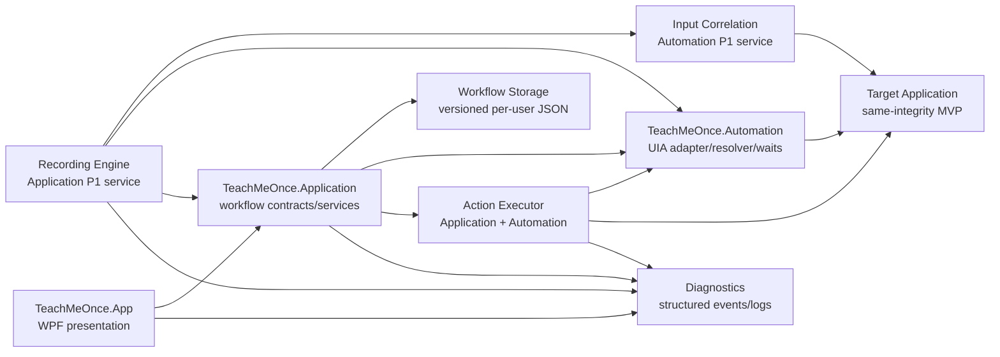
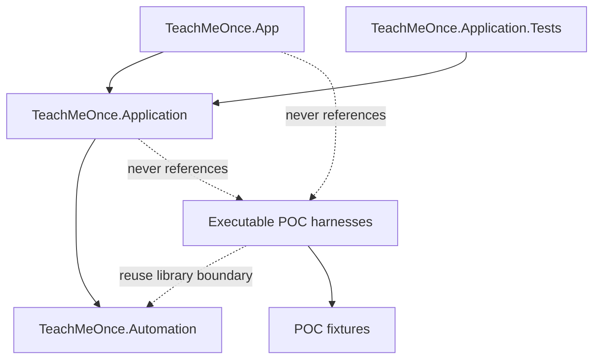
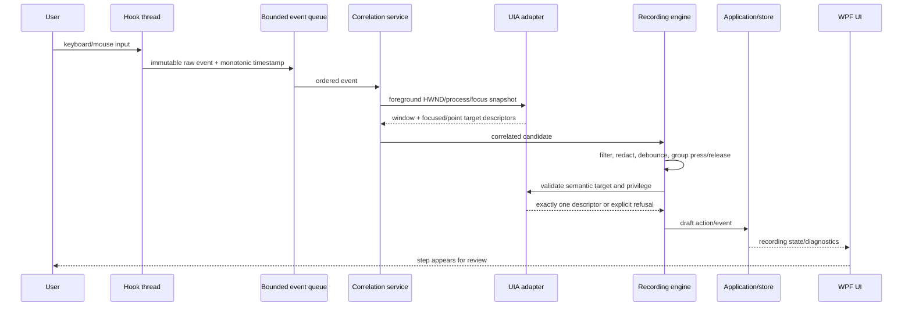
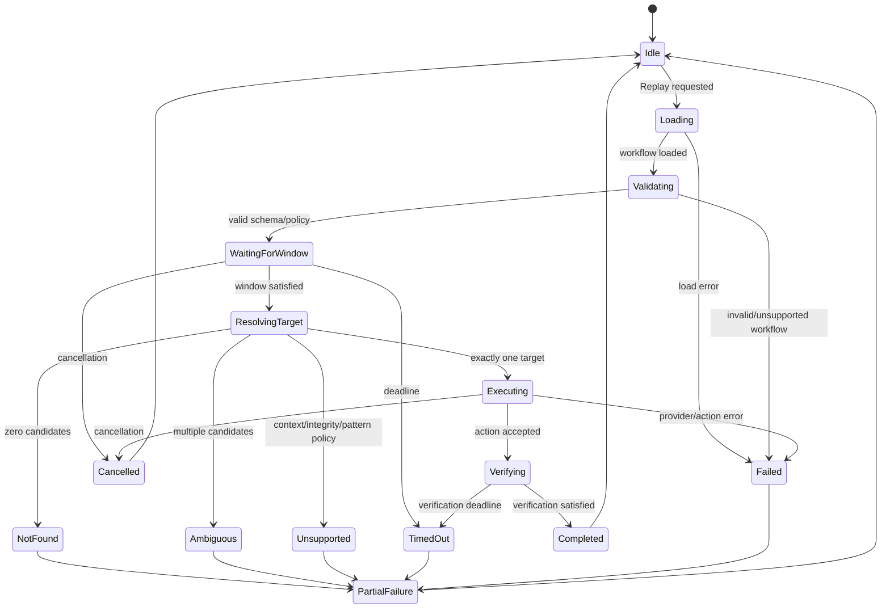

# TeachMeOnce system architecture

## 0. Status and scope

This document is the product architecture specification after the feasibility
POCs. It describes the complete intended platform while distinguishing source
that exists today from planned product work. It does not add another POC and it
does not claim that planned subsystems are implemented.

The prioritized delivery plan is [`implementation-backlog.md`](implementation-backlog.md);
durable decisions are recorded in [`adr/`](adr/). The existing
[`first-vertical-slice.md`](first-vertical-slice.md) remains the runbook for the
current product slice.

### Repository evidence

| Area | Current source/evidence | Status |
| --- | --- | --- |
| WPF product shell | `src/TeachMeOnce.App` | Implemented first slice plus external target list/attach/record controls; interactive P1 evidence pending |
| Workflow contracts, persistence, diagnostics, recording, replay | `src/TeachMeOnce.Application` | Implements Invoke and SetValue external-session path; broader action model planned |
| Reusable UIA descriptor/resolver/waits | `src/TeachMeOnce.Automation`, linked from POC-03/04 source | Implements external window selection, integrity inspection, low-level input session, and live UIA correlation |
| Application contract tests | `src/TeachMeOnce.Application.Tests` | Implemented executable tests; latest hardening run must be verified on Windows |
| Global input capture/correlation | `src/TeachMeOnce.Automation` plus POC-02 client boundary | Product session service implemented; POC-02 regression behavior remains isolated |
| Display/DPI | `src/TeachMeOnce.DisplayRobustness` | Feasibility evidence; current report is Partial on one-monitor/one-DPI hardware |
| Privilege boundary | `src/TeachMeOnce.PrivilegeBoundary` | Same-integrity passes; higher-integrity interaction is Unsupported by MVP policy |
| Custom-rendered fallback | `src/TeachMeOnce.CustomRenderedFallback` | Feasibility evidence; product action type and policy integration planned |
| Deployment | `src/TeachMeOnce.DeploymentProbe`, `DeploymentSmoke` | All local POC-08 modes passed; clean-machine compatibility remains unverified |

The exact SDK remains `10.0.402`, the target remains `net10.0-windows`, and the
runtime identifier remains `win-x64`. UI Automation and input tests require an
interactive Windows desktop.

## 1. System architecture

### 1.1 Boundary diagram



### 1.2 Dependency graph



Executable feasibility projects remain test clients. The application must only
depend on reusable libraries. When a POC implementation becomes product code,
move or link its implementation into a library boundary and make the POC a
client of that boundary; do not copy behavior into the app.

### 1.3 Component responsibilities

| Component | Responsibility | Current boundary |
| --- | --- | --- |
| WPF UI | Workflow library, controls, state, progress, diagnostics presentation, permissions/settings | `TeachMeOnce.App/MainWindow.xaml(.cs)` |
| Application layer | Use cases, contracts, persistence orchestration, recording/replay policy, cancellation, diagnostics | `TeachMeOnce.Application` |
 | Recording engine | Own a recording session, consume correlated input, filter/redact, create semantic actions | `TeachMeOnce.Application/ExternalRecording.cs` |
 | Input-correlation service | Global hook ownership, bounded event queue, UIA/native window correlation, ordering | `TeachMeOnce.Automation/InputCapture.cs` |
| UIA adapter | STA/MTA-safe access wrapper, property/pattern reads, process/window context, stale handling | POC-derived `TeachMeOnce.Automation`; expand behind interfaces |
| Target resolver | Descriptor matching, exactly-one invariant, ambiguity/context failure | POC-derived and used by first slice |
| Wait engine | Bounded asynchronous polling, cancellation, timeout and UIA error states | POC-derived and used by first slice |
 | Action executor | Map action types to adapters, verify, report partial failure, enforce privilege policy | Registry-backed Invoke, SetValue, and TextInput adapters; broader action set planned |
| Workflow storage | Versioned JSON, atomic writes, validation, migrations, per-user paths | First slice JSON store; migrations planned |
| Diagnostics | Structured entries, redacted logs, correlation IDs, user-facing failure details | First slice log; structured schema/retention planned |
| Display context | DPI/monitor/coordinate-space evidence and fallback policy | POC evidence; product contract planned |

## 2. Threading and process model

### 2.1 Threads

- The WPF UI thread owns controls, presentation state, and UI-bound diagnostic
  updates. It must not run blocking hook reads, file I/O, or long UIA polling.
- The recording engine owns a session coordinator and receives immutable events
  from the input-correlation service.
- Low-level input hooks run on their dedicated message-loop thread as proven by
  POC-02. Hook callbacks enqueue compact immutable records and return quickly.
- UIA access must use a controlled apartment strategy. UIA element references
  are short-lived; the resolver reacquires current elements instead of storing
  COM references in workflows.
- Persistence and diagnostics use asynchronous file I/O or bounded background
  work and publish results back to the UI through application events/commands.
- Replay is a cancellable application operation. It never blocks the UI thread;
  cancellation is cooperative and checked before each action, wait, retry, and
  verification step.

### 2.2 Process and integrity model

- The application, recorder, and executor run as the standard user process in
  the MVP.
- Same-integrity target interaction is supported by policy.
- A higher-integrity target is detected and returned as `Unsupported`; the
  system must not add a helper, service, UIAccess executable, UAC bypass, or
  silent elevation.
- No component may force-terminate an elevated target during cleanup.

## 3. Recording pipeline

### 3.1 Data-flow diagram



### 3.2 Capture and ordering

1. Start a recording session with a session ID, target policy, and cancellation
   token.
2. Install the hook service only for the session; stop it deterministically in
   `finally`/shutdown paths.
3. Capture input kind, message, timestamp, monotonic sequence, injected flag,
   screen coordinates, virtual key/scan code, and button state.
4. Use a bounded queue. If capacity is exceeded, do not silently drop events;
   surface a recording failure with the dropped count and stop or require user
   confirmation according to policy.
5. Correlate each event to the current foreground HWND, native process ID/name,
   UIA root, focused element, and point element. Verify native and UIA process
   identity agree when both are available.
6. Preserve ordering by monotonic sequence, not wall-clock time alone. Pair
   mouse down/up and key down/up events; discard duplicate provider notifications
   only with an explicit correlation rule.

### 3.3 Filtering and privacy

- Ignore injected events generated by TeachMeOnce unless the recording policy
  explicitly marks them as test input; never record the tool's own replay as a
  user action.
- Ignore system/secure-desktop events, unrelated windows, and events outside the
  recording target scope.
- Redact password controls, password-like text, secure edit fields, clipboard
  contents, and configured sensitive control names. Store only a redaction marker
  and diagnostic reason.
- Do not persist raw keystrokes by default. Text entry must be a separate,
  explicitly consented action type with protected storage policy; the MVP may
  refuse text recording rather than capture secrets.
- Debounce hover/move noise and coalesce a click into one semantic action after
  focus/target evidence stabilizes.

### 3.4 Semantic conversion

- Prefer UIA control patterns and stable AutomationId/name/control type/context.
- Build a descriptor containing process context, top-level window context,
  target properties, required patterns, and control-view ancestry.
- Require exactly one candidate. Zero candidates, duplicates, stale elements,
  process mismatch, context mismatch, or unsupported privilege produce an
  explicit refusal and diagnostic; no nearest/best guess is allowed.
- Record display/DPI context only when an explicit coordinate fallback action is
  created. Semantic actions must not depend on screen coordinates.

## 4. Workflow model

### 4.1 Versioned envelope

The persisted format is a versioned document, not a direct dump of COM objects:

```json
{
  "schemaVersion": 1,
  "id": "workflow-guid",
  "name": "Example workflow",
  "application": {
    "processName": "Target.exe",
    "frameworkId": "WPF",
    "integrityPolicy": "SameIntegrityOnly"
  },
  "actions": [
    {
      "actionType": "Invoke",
      "description": "Invoke the target button",
      "target": {
        "process": { "processId": 1234, "processName": "Target", "identityPolicy": "ProcessName" },
        "window": { "automationId": "MainWindow", "controlType": "ControlType.Window" },
        "element": { "automationId": "SaveButton", "controlType": "ControlType.Button", "requiredPatterns": ["Invoke"] },
        "ancestors": []
      },
      "verification": { "automationId": "StatusText", "expectedValue": "Saved" }
    }
  ]
}
```

The current source model is `WorkflowDocument`/`WorkflowAction` in
`TeachMeOnce.Application`; its first version stores a `TargetDescriptor` from
the reusable automation boundary and supports `Invoke` plus verification
metadata. The complete model must add the following explicitly rather than
silently changing version 1.

### 4.2 Planned action types

- `Invoke`: `InvokePattern`.
- `SetValue`: `ValuePattern` with secret/redaction policy.
- `TextInput`: explicit non-sensitive semantic text action for controls that
  expose readable `TextPattern` but not writable `ValuePattern`; replay uses
  focused same-integrity keyboard input and verifies the resulting text.
- `Toggle`: `TogglePattern` with expected final state.
- `Select`: `SelectionItemPattern`/selection context.
- `ExpandCollapse`: `ExpandCollapsePattern`.
- `CoordinateFallback`: separate action with display/geometry/evidence contract;
  never an alternate representation of a semantic action.
- `Wait`: explicit bounded wait/condition action when a workflow needs a
  transition boundary.

### 4.3 Target and context data

Required semantic target data:

- process name and recorded process ID policy;
- process identity policy: strict PID plus name for stable external targets, or
  process name within the selected same-integrity application when a workflow
  must survive that application's restart;
- integrity level/policy at record time;
- top-level window AutomationId/name/class/framework/control type;
- target AutomationId/name/control type/class/framework/password state;
- required UIA patterns;
- control-view ancestry;
- optional application identity/version and user-selected context.

Required coordinate fallback data, only for that action type:

- coordinate-space version and origin (`client`, `window`, or `screen`);
- recorded client/window bounds, DPI, monitor identity, work area and resolution;
- target safe rectangle/inset and evidence source;
- candidate uniqueness/confidence and post-action verification contract.

### 4.4 Validation, migration, compatibility

- Validate schema version, required fields, action type, descriptor completeness,
  pattern compatibility, privilege policy, and coordinate-space version before
  execution.
- Unknown future versions are rejected with an actionable message; they are not
  guessed or partially executed.
- Migrations are pure, version-to-version transforms with fixtures and a
  migration report. Preserve the original file until the migrated file is
  atomically written and validated.
- Corrupt or unsupported files are isolated as load issues; valid workflows
  remain visible. The current JSON store implements this per-file behavior in
  source; the latest hardening run must be verified on Windows.

## 5. Replay engine

### 5.1 State machine



### 5.2 Execution rules

- Validate the workflow before starting and capture a replay correlation ID.
- Resolve the target from the current UIA tree for every action; never reuse a
  recorded `AutomationElement` reference.
- Require exactly one result. `NotFound`, `Ambiguous`, `ContextMismatch`, and
  `InvalidDescriptor` are distinct diagnostics and user-visible states.
- Check process identity and same-integrity policy immediately before action.
- Supported UIA patterns are action-specific. The adapter must check pattern
  presence and enabled state before invocation.
- Use bounded asynchronous waits for window, target, enabled state, and
  verification. Cancellation must interrupt every wait and action boundary.
- Verify observable postconditions where configured. A successful provider call
  alone is not a completed workflow step.
- Safe retry is limited to reacquiring the same descriptor after a known stale
  provider/layout refresh, with a bounded count and no alternate target. Never
  retry an ambiguous result, another coordinate, or another process.
- A partial failure reports completed action count, failed action ID, state,
  timeout/cancellation/provider detail, and recovery options. It does not silently
  continue unless the workflow explicitly declares a future recoverable policy.

## 6. Coordinate fallback

Coordinate fallback is an explicit `CoordinateFallback` action and is not a
semantic target substitute.

### 6.1 Preflight contract

Before input, the executor must verify all of:

1. expected process still exists;
2. HWND is current, visible, enabled, and belongs to the expected process;
3. root ancestor/window identity has not been reused;
4. window is foreground or activation succeeded and foreground PID/HWND is
   reverified;
5. current client/window bounds and DPI are available;
6. coordinate conversion uses the recorded coordinate-space version and current
   DPI, never a stale physical screen point;
7. candidate is inside the current client rectangle and safe target inset;
8. point is not a border, resize grip, title bar, taskbar, decoy, or ambiguous
   region;
9. `WindowFromPoint` and root ownership resolve to the expected target;
10. visual/fixture evidence is unique and sufficiently fresh;
11. UIA `FromPoint` is recorded as diagnostics only; generic UIA does not prove
    semantic identity;
12. same-integrity policy is satisfied.

Any failed or unknown precondition means `CoordinateRejected`/`Unsupported` and
no input. There is no retry at another point.

### 6.2 Execution and verification

- Convert client coordinates to screen coordinates at the final step.
- Inject exactly one bounded input sequence after preflight.
- Record injected status, coordinates, HWND/process evidence, and UIA point
  classification.
- Verify the expected visual/UIA/native postcondition. If verification fails,
  return failure; do not click again.
- Record DPI, monitor, resolution, work area, layout revision, and evidence source
  for diagnosis and future migration.

POC-07 proves this pipeline only against fixture-known geometry. It does not
prove general visual discovery for arbitrary applications.

## 7. Security and reliability

### 7.1 Security

- Same-integrity targets are the MVP supported boundary.
- Higher-integrity targets produce `Unsupported` before interaction; inspection
  and interaction are separately reported.
- No elevated helper, service, UIAccess, UAC bypass, or silent retry.
- Redact password/sensitive input and avoid persisting raw keystrokes by default.
- Store workflow data under per-user LocalAppData with restrictive normal user
  ACL expectations; never require admin write access.
- Diagnostic logs must exclude secrets, raw text values, tokens, and full input
  payloads.

### 7.2 Reliability

- Use bounded queues and expose overflow as an explicit recording failure.
- Own every hook, UIA worker, timer, cancellation source, file stream, and
  process/window subscription; dispose them in success, cancellation, and crash
  paths.
- Serialize workflow writes through temporary files and atomic replacement.
- Use a session/replay correlation ID in diagnostics.
- Recover startup by loading valid workflows, isolating bad files, and showing
  actionable diagnostics.
- Never force-terminate unrelated or elevated processes.
- Serialize conflicting record/replay operations; do not run two replay sessions
  against the same target without an explicit future concurrency policy.

## 8. User experience

### 8.1 Workflow library

- Show workflow name, action count, last modified time, schema status, and last
  result.
- Distinguish valid, migrated, invalid, unsupported, and partially failed files.
- Allow rename/delete/export only after persistence and privacy policy are defined.

### 8.2 Recording and editing

- Record/Stop controls show a clear state and session target scope.
- Show captured steps as semantic descriptions, not raw COM data or unexplained
  coordinates.
- Allow inspection of target context, patterns, verification, redaction state,
  and fallback evidence before saving.
- Refuse recording when target identity or integrity policy is unsafe.

### 8.3 Playback

- Show current action, wait/resolution/verification phase, elapsed time, and
  cancel control.
- Pause is a future state-machine capability; cancellation is required now and
  must return a safe terminal state.
- Failure view includes action description, target context, status, reason,
  diagnostics ID, retry eligibility, and recovery guidance.

### 8.4 Permissions/settings

- Explain interactive desktop/UIA requirements, same-integrity limitation,
  sensitive-data policy, and per-user data paths.
- Never present a privilege escalation prompt as an automatic product fix.

## 9. Deployment and operations

- Build with SDK `10.0.402`; target `net10.0-windows`/`win-x64`.
- Current deployment recommendation is self-contained folder publish. Single-file
  is optional until clean-machine, antivirus, extraction, diagnostics, and update
  checks pass.
- POC-08 published output validates launch, UIA, configuration, LocalAppData
  writes, logging, and error reporting on the development machine. Its
  `cleanMachineTested=false` must remain visible.
- Product data paths:
  - workflows: `%LOCALAPPDATA%\TeachMeOnce\Workflows`;
  - application log: `%LOCALAPPDATA%\TeachMeOnce\teachmeonce.log`;
  - future diagnostics: versioned per-user diagnostic directory with retention.
- Configuration must be versioned, validated, and separate from mutable workflow
  data. Do not rely on the current working directory.
- Structured logs should include timestamp, severity, correlation ID, workflow
  ID/action ID, process/window context, and redacted reason.
- Deployment acceptance requires the Release build, application tests, POC
  regressions, published smoke, and a separate clean Windows x64 run before a
  clean-machine claim.

## 10. Implemented versus missing map

### Implemented source

- UI shell, workflow list, Record/Stop/Replay/Cancel, state, diagnostic list:
  `src/TeachMeOnce.App`.
- Versioned workflow model, JSON store, diagnostics, semantic recorder, one
  Invoke replay path: `src/TeachMeOnce.Application`.
- Reusable deterministic descriptor/resolver and cancellable waits:
  `src/TeachMeOnce.Automation` (linked from the proven POC-03/04 source).
- Contract/persistence tests: `src/TeachMeOnce.Application.Tests`.
- POC-02 hook/correlation, POC-05 display, POC-06 privilege, POC-07 fallback,
  and POC-08 deployment evidence remain in their executable harnesses.

### Missing product capabilities

- Full session support beyond the P1 Invoke/SetValue path, including richer event grouping and additional action adapters.
- Fixture-backed interactive P1 evidence for WPF/WinForms and Notepad.
- Full UIA action adapters beyond Invoke and SetValue.
- Text/password redaction policy and secure action storage.
- Workflow migrations and backwards-compatible schema registry.
- Robust verification contracts and action-specific recovery policy.
- Product coordinate fallback implementation using the POC safety contract.
- Display/DPI completion on multi-monitor, mixed-DPI, and negative-coordinate
  hardware.
- Installer/signing/update/rollback and clean-machine deployment evidence.

## 11. Key risks

| Risk | Consequence | Mitigation |
| --- | --- | --- |
| UIA provider instability/staleness | replay failures or false targets | bounded reacquisition, exact matching, stale classification, verification |
| Duplicate or weak target metadata | unsafe action | ambiguity refusal; require user review or explicit fallback |
| Global hook noise/overflow | corrupt recording order | dedicated hook thread, bounded queue, sequence IDs, overflow failure |
| Sensitive input capture | privacy/security incident | redact/refuse by default; never log raw secrets |
| DPI/layout changes | wrong coordinate action | semantic-first; coordinate contract, current preflight, stale rejection |
| Higher-integrity target | blocked or unsafe automation | explicit Unsupported MVP policy; no privilege escalation |
| Corrupt workflow data | lost library entries | per-file load issues, version validation, atomic writes, migrations |
| Deployment/runtime drift | launch failure | self-contained folder candidate and published smoke; clean-machine gate |
| UI thread blocking | frozen app/unsafe cancellation | async operations and dedicated service boundaries |

## 12. Exact first implementation milestone

The next implementation milestone is **Product Slice 1: harden and verify the
existing same-integrity semantic workflow** before adding new action types:

1. Run the Release build and `TeachMeOnce.Application.Tests` after the current
   persistence hardening.
2. On Windows, record one demo click, save, close, relaunch, reload, replay, and
   verify `Status: invoked`.
3. Add a focused UI integration smoke around that restart flow.
4. Verify malformed/unsupported workflow diagnostics, cancellation, and
   missing/ambiguous resolver outcomes.
5. Preserve POC-05 `Partial`, POC-06 cross-integrity `Unsupported`, and POC-08
   `cleanMachineTested=false` in the report.

Completion gate: Release build passes; application tests pass; the restart flow
passes on an interactive Windows desktop; the relevant POC regressions pass or
retain their explicit limitations; no external-process recording is started
until this slice is reviewed.
